<picture>
  <source media="(prefers-color-scheme: dark)" srcset="assets/header-dark.svg">
  
</picture>

I work on LLM agents for code, multi-objective search, and uncertainty in machine learning. MSc in AI & Data Engineering at UCL; BSc (First Class Honours) at Heriot-Watt.

## Research

**[Multi-objective search over the decoding policy of a multi-agent LLM pipeline for automated program repair](https://github.com/Kasra-Sartaee/apr-decoding-policy-search)** 
MSc dissertation, UCL. A four-stage agent pipeline (Analyzer → Repair → Verifier → Optimizer) on a 1.5B code model, whose 11 decoding and retry parameters are tuned for correctness, code complexity and measured energy. NSGA-II, random search and Bayesian optimisation (qLogNEHVI) each get the same 750-evaluation budget over five repetitions on Codeflaws (C), with transfer to RunBugRun (Python). Energy is measured with RAPL under a two-phase protocol, and no reported number is transcribed by hand.

**[EchoScript: Enhancing AI Music Generation for Cinematic Scoring via Script-Aware Fine-Tuning](https://summer-symposia-proceedings.aaai.org/preprints/pdfs/389.pdf)** 
With Kayvan Karim. Published in the AAAI Symposium Series. Fine-tunes MusicGen to score film scenes from their scripts.

<!-- Uncomment and add the link:
**[SURVEY TITLE](LINK)** 
CO-AUTHORS. Published in IJDSAA. A survey of uncertainty, disagreement and information fusion in AI systems.
-->

## Projects

**[EconPulse](https://github.com/Kasra-Sartaee/econpulse)**: open-source desktop economic calendar with a floating countdown widget, alerts and an English/Persian interface. Python on Windows, macOS and Linux, with CI, CodeQL and an OpenSSF Scorecard.

**[Distributed ML inference case study](https://github.com/Kasra-Sartaee/distributed-ml-inference-case-study)**: ResNet-50 inference over 7.2M images on a five-node, CPU-only Kubernetes cluster with Spark, Airflow, MLflow and MinIO, in a 25-hour unattended run.

---

[kasrasartaee.com](https://kasrasartaee.com) · [Email](mailto:kasrasartaee@yahoo.com)
<!-- add: · [Google Scholar](LINK) · [LinkedIn](LINK) -->
