<a href="https://kasrasartaee.com">
  <picture>
    <source media="(prefers-color-scheme: dark)" srcset="dark_mode.svg">
    
  </picture>
</a>

### Selected work

- **[Multi-Objective Search over the Decoding Policy of a Multi-Agent LLM Pipeline for Automated Program Repair](https://github.com/Kasra-Sartaee/apr-decoding-policy-search)** 
  MSc dissertation, UCL. NSGA-II, random search and Bayesian optimisation compared at a matched evaluation budget, over correctness, code complexity and measured energy.
- **[EchoScript: Enhancing AI Music Generation for Cinematic Scoring via Script-Aware Fine-Tuning](https://summer-symposia-proceedings.aaai.org/preprints/pdfs/389.pdf)** 
  M. K. Sartaee, K. Karim. Published in the AAAI Symposium Series.
<!-- Uncomment and fill in once you have the link:
- **[SURVEY TITLE](LINK)** 
  CO-AUTHORS. Published in IJDSAA.
-->
- **[EconPulse](https://github.com/Kasra-Sartaee/econpulse)** 
  Open-source desktop economic calendar with a floating countdown widget, alerts and Persian support. Python; Windows, macOS, Linux.

[Website](https://kasrasartaee.com) · [Email](mailto:kasrasartaee@yahoo.com)
<!-- add: · [Google Scholar](LINK) · [LinkedIn](LINK) -->
